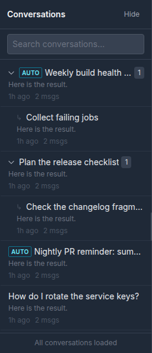

# Agent Runs REST API

Last updated: 2026-11-20

The agent-runs API lets one trusted external service -- a scheduler, a CI job, a webhook
relay -- start an ATLAS agent conversation on behalf of a user, with no browser or CLI session,
then poll it, send it follow-up messages, and stop it (issue #1105). It is the REST form of the
sub-conversation tools a conversation already has (`atlas_discover_subagent_options`,
`atlas_launch_subagent`, `atlas_get_subagent_runs`, `atlas_get_subagent_result`, `atlas_follow_up_subagent`), and runs on the same
machinery: the same workspace and model checks, the same re-filtering of tools and data sources
through the user's ACLs, and the same run registry and concurrency caps.

## Enabling it

```bash
# Off by default. Also requires chat history and agent mode.
FEATURE_AGENT_RUNS_API_ENABLED=true
# The master key, at least 32 characters. Generate one with:
#   python -c "import secrets; print(secrets.token_urlsafe(48))"
AGENT_RUNS_API_KEY=...
```

- **One key, one trusted service, any user.** The key is a service credential, not a user
  token: whoever holds it can launch runs as *any* user, using that user's workspaces, models,
  tools and data sources. Treat it like a root credential, keep it in a secret store, and rotate
  it by changing the variable and restarting. Per-user tokens, scopes and delegation allowlists
  are not part of this first version.
- **Fail closed.** With the feature off, every `/api/agent-runs` path returns 404. With it on
  but the key unset or shorter than 32 characters, every request returns 503 and the server logs
  an error; nothing is served unauthenticated.
- **The key is the only credential.** `/api/agent-runs` is exempt from the browser
  authentication middleware: the identity header, the proxy secret and an OIDC session neither
  grant access nor are required. A signed-in user's browser therefore cannot call these
  endpoints. If a reverse proxy enforces its own login on every path, exempt `/api/agent-runs`
  from it (as for `/mcp/files/download/`) so the service can reach the backend with its bearer
  key. The key is compared in constant time and never logged.
- **The email domain whitelist still applies, to the target user.** With
  `FEATURE_DOMAIN_WHITELIST_ENABLED`, the browser path checks the signed-in user in middleware;
  the service has no signed-in user, so the whitelist is applied to the `user` a request acts as
  instead, and a user outside it is refused with `403 user_not_allowed`.
- `AGENT_RUNS_API_KEY` is masked in the admin panel's configuration view like other keys.

## Endpoints

A terminal run also carries `end_reason`: `completed`, `user_cancelled`, `error`, `wall_clock_limit`, `replica_shutdown` when the replica running it shut down, `owner_lost` when the owning replica lost its lease, or `fenced` when execution was interrupted by fencing (see [Multi-Replica Observability](multi-replica-observability.md)).

All requests carry `Authorization: Bearer <AGENT_RUNS_API_KEY>`. The full schema is in the
server's OpenAPI document (`/openapi.json`, browsable at `/docs`) under the `agent-runs` tag.

| Method and path | Mirrors | Purpose |
|---|---|---|
| `GET /api/agent-runs/options?user=` | `atlas_discover_subagent_options` | Workspaces and models the user may launch with, LiteLLM gateway team models included (not filtered by compliance level; the launch request's level is checked at admission) |
| `POST /api/agent-runs` | `atlas_launch_subagent` | Start a run in a new top-level conversation |
| `GET /api/agent-runs?user=` | `atlas_get_subagent_runs` | API-started runs still retained (optionally one user's) |
| `GET /api/agent-runs/{run_id}` | `atlas_get_subagent_result` | Status, timestamps, error, `end_reason` and final reply |
| `POST /api/agent-runs/{run_id}/follow-up` | `atlas_follow_up_subagent` | Next message in that run's conversation |
| `POST /api/agent-runs/{run_id}/cancel` | Stop in the UI | Stop the run and anything it launched |

### Launch

```bash
curl -sS -X POST https://atlas.example.com/api/agent-runs \
  -H "Authorization: Bearer $AGENT_RUNS_API_KEY" -H "Content-Type: application/json" \
  -d '{
        "user": "user@example.com",
        "workspace": "Build triage",
        "model": "gpt-4o",
        "message": "Analyze the failed build and summarize the failures",
        "compliance_level": "Internal",
        "idempotency_key": "build-1234"
      }'
```

Returns `202 Accepted` as soon as the run is admitted, with a `Location` header and a handle:
`run_id`, `conversation_id`, `status`, `status_url`, the resolved `workspace`, `model`, `tools`
and `data_sources`, and `tools_needing_approval`. The run keeps going after the response.

- `workspace` is one of the user's saved workspaces, by id or name. It is the run's whole
  capability surface: its tools (re-filtered through the user's ACLs now) and, when the
  workspace has RAG switched on, its data sources (authorized for the user and compliance level).
- `model` must be one the user may use; an unknown model and a forbidden one get the same answer.
- `compliance_level` is the conversation's classification. It is validated, and the model, tools
  and data sources are checked against it, before the run is admitted; it is then fixed for the
  conversation -- follow-ups always run at it.
- The run is a top-level conversation in the user's history (no parent), titled by its message,
  and shows in their sidebar while it runs. The user can open it, watch it, and continue it.
- The sidebar marks the conversation with a small **AUTO** tag (tooltip "Started
  programmatically via the Agent Runs API.") so the user can tell it from one they started themselves. See
  [How the user sees an API conversation](#how-the-user-sees-an-api-conversation).

### Poll, follow up, cancel

`GET /api/agent-runs/{run_id}` returns `status` (`queued`, `running`, `waiting_for_input`,
`completed`, `failed`, `cancelled`), `waiting_on`, `created_at` / `updated_at` / `ended_at` (Unix
seconds), `error`, and once completed `result` with `result_status` (`available`,
`available_truncated` past 20,000 characters, `empty`, `unavailable`). `interrupted` is `true` when
the server running the run was lost (crashed, or unreachable past its lease) and the run was
marked `failed`; tool calls it had finished are kept and none is retried.
With several replicas, any one answers for any run; when the shared run state cannot be read
at that moment it returns `503 unavailable` rather than `404`, so retry the poll instead of
launching again.

`POST /api/agent-runs/{run_id}/follow-up` with `{"message": "..."}` starts the next turn of that
run's conversation, as the conversation's owner, on the workspace, model and compliance level it
was launched with -- each re-checked against the owner's access now. The conversation's stored
history is loaded first, so the model sees the whole transcript. A follow-up is refused while the
conversation has a run in progress or is waiting for the user, and for a conversation whose
launch never completed. Any of the conversation's run ids may be used; the newest one's
capabilities are the ones carried forward.

`POST /api/agent-runs/{run_id}/cancel` stops the run (and any sub-conversations it launched with
`atlas_launch_subagent`), exactly like the stop button. `cancelled` says whether anything was still live.
As with follow-ups, any of the conversation's run ids may be used: if the run named has already
finished, the conversation's in-progress API run (a later follow-up) is stopped instead, and the
response describes that run. The named run's own sub-conversations are stopped either way. A turn
the user started themselves in ATLAS is never stopped.

### Errors

Refusals are JSON `{"detail": {"code": "...", "message": "..."}}`:

| HTTP | `code` | Meaning |
|---|---|---|
| 400 | `invalid_request` | Missing or oversized field |
| 401 | `unauthorized` | Missing or wrong bearer key |
| 403 | `user_not_allowed` | The target user is outside the email domain whitelist |
| 404 | `not_found` | The API is disabled |
| 404 | `workspace_not_found` | No such workspace *for that user* (another user's workspace looks the same) |
| 404 | `run_not_found` | Unknown run, expired, or not started through this API |
| 409 | `approval_required` | The workspace has approval-mandatory tools (see below) |
| 409 | `conversation_busy` | The conversation already has a run in progress |
| 409 | `waiting_for_input` | The conversation is paused on the user |
| 409 | `not_continuable` | Nothing to follow up on |
| 409 | `idempotency_conflict` / `idempotency_in_progress` | Key reused with a different body / first request still admitting |
| 422 | `model_not_available` / `no_authorized_tools` / `classification_refused` | The user may not use the model, has no usable tools in the workspace, or the classification does not allow a component |
| 429 | `concurrency_limit` | The user is at `MAX_CONCURRENT_RUNS_PER_USER` |
| 503 | `not_configured` / `persistence_unavailable` / `unavailable` | Key missing or weak, chat history unavailable, workspaces or a dependency (such as the Redis run coordinator) unavailable |

A body that fails schema validation (a wrong type, a missing `message`, a body that is not JSON) is answered
before any of the above with FastAPI's standard `422`, whose `detail` is a **list** of
`{"loc", "msg", "type"}` objects rather than a `{code, message}` object. Clients should branch on
the type of `detail`.

## How the user sees an API conversation

A conversation this API launched carries an **AUTO** tag before its title in the history sidebar
(issue #1187). The tag is there while the run is in flight and stays after the run has finished,
the page is reloaded, the run registry has forgotten the run, or the backend has restarted.



In the screenshot, "Weekly build health report" and "Nightly PR reminder" were launched by the
API. The first also launched a sub-conversation, so it shows the tag next to the tree controls.
"Plan the release checklist" is an ordinary conversation with a sub-conversation, and "How do I
rotate the service keys?" is an ordinary conversation.

The origin is recorded in the conversation's metadata when its first turn is saved:

```json
{"launch_origin": "agent_runs_api"}
```

- It is server-written. Only this API's launch path supplies it; no websocket frame or request
  body can set it.
- It is fixed at creation. The user continuing the conversation in the browser does not remove
  it, and no later save can add it to a conversation that was not launched here.
- It names the launch surface only. The calling service, its key and its request are not stored
  in it.
- `GET /api/conversations`, `/api/conversations/search`, `/api/conversations/{id}` and
  `/api/conversations/export` publish it as `launch_origin` (`null` for every other
  conversation). The run snapshot and `run_status` frames carry the same field, which is what
  marks a run that has not been saved yet. This API's own responses are unchanged.
- A sub-conversation that an API run starts with `atlas_launch` has no origin of its own. It is
  nested under the API conversation by its parent link, like any other sub-conversation.

On a multi-replica deployment, a browser attached to a replica that does not hold the run learns
the run from the shared execution projection, which does not carry the origin. That row shows
its run state straight away and gains the tag at the conversation's first save. The saved record
is in PostgreSQL, so every replica shows the tag from then on.

## Approvals

Ordinary tool approvals are given by the service: the request that names the task is the
approval, the same way a user's approval of an `atlas_launch_subagent` call covers the sub-conversation's
own tool calls. Tools an administrator has made approval-mandatory (`FORCE_TOOL_APPROVAL_GLOBALLY`
or per-tool configuration) are **never** auto-approved:

- By default a launch or follow-up whose tools include one is refused with `409
  approval_required`, naming the tools, before anything runs.
- With `"allow_approval_pause": true` the run is admitted, each mandatory tool call prompts (the
  other tools run), and the run pauses as `waiting_for_input` until the user opens the conversation in ATLAS and answers. The
  handle's `tools_needing_approval` lists the mandatory ones. Paused runs count toward the user's
  concurrency cap, and `TOOL_APPROVAL_TIMEOUT_SECONDS` applies as usual.

## Idempotency

Send an `idempotency_key` (any caller-chosen string up to 200 characters) to make retries safe.
A repeat with the same key and the same body, for the same user, returns the original handle
with HTTP 200 and `idempotent_replay: true` rather than launching again; the same key with a
different body is a 409. Two simultaneous requests with one key launch once; the loser gets
409 `idempotency_in_progress` while the first is still admitting (retry shortly, it then replays).
A request that was refused or failed to launch does not consume its key. Keys share one namespace
per user across launches and follow-ups, so use a distinct key for each request (reusing a
launch's key for its follow-up is a 409 `idempotency_conflict`). Keys are remembered for 24 hours.
A replay of a follow-up still works after the run it addressed has been cleaned up. When the
replayed run itself is no longer tracked, the handle's `status` is `expired` (a value only
replays carry); its conversation is still in the user's history.

With `SESSION_REPOSITORY_TYPE=redis` the keys are cluster-wide: the same key and body sent to
any replica launches one run, and a replay on a replica other than the one that accepted the
launch returns the original `run_id` and `conversation_id` with HTTP 200, and the run's current
`status` read from its shared record. A reservation is made atomically in Redis before anything
is admitted and extended while the request is still admitting. If the replica handling a first
request dies before it records the run, the reservation frees itself 2 minutes later. If Redis cannot be reached, a request that carries an
`idempotency_key` is refused with `503 unavailable` (nothing is launched, and the same key works
once Redis is back, though a request that timed out reaching Redis can leave the key reserved
for up to those 2 minutes, during which a retry gets 409 `idempotency_in_progress`); requests
without a key are unaffected. If Redis fails only after the run was admitted, the replica keeps
retrying to record the run (for up to 2 minutes) so a later retry still replays it.
If the reservation is lost while a request is still admitting (another request took the key, or
Redis stayed unreachable for the 2 minute pending window), that request is aborted and answers
`503 unavailable` with nothing left running (a run admitted a moment before the loss is
cancelled); the loss is counted as an `idempotency_reservation_lost` coordination event. A retry of a follow-up replays on
any replica, naming either the run it addressed or any other run of that conversation (the
conversation is read from the run's shared record, normally kept 30 minutes after the run ends; after that,
only the originally addressed run id replays; if that record cannot be read the retry is refused
with `503 unavailable` rather than `404`). The shared keys have no entry cap: each is one
small hash, kept at most 24 hours, and only the one trusted service holding the master key can
create them, so memory is bounded by its request rate times 24 hours. Without Redis the keys live in the
memory of the replica that accepted them and are lost on restart.

## Limits, replicas and restarts

- `MAX_CONCURRENT_RUNS_PER_USER` and `MAX_RUN_WALL_CLOCK_SECONDS` apply to API runs as to any
  other. With Redis the cap counts the user's runs on every replica, browser runs included; the `atlas_launch_subagent` depth and fan-out caps do not apply to the API run itself (it is a
  root, depth 0) but do apply to anything it launches. The global HTTP rate limiter applies to
  these endpoints. Messages are limited to 20,000 characters.
- **Redis-backed replicas share retained API run state.** With
  `SESSION_REPOSITORY_TYPE=redis`, status, follow-up, listing and cancel can
  be requested on any replica. The retained run records normally expire 30
  minutes after completion; they are not durable history. A follow-up checks
  the latest API admission for the conversation and starts a new run on the
  receiving replica, including after the previous replica has restarted.
  The new admission checks the predecessor atomically with the conversation
  claim, so a concurrent turn cannot restore older tool permissions. Missing
  continuation metadata or unavailable Redis produces `503 unavailable`,
  rather than falling back to local admission. A stale predecessor produces
  `409 conversation_busy`; retry the request to resolve the latest state.
  Cancellation still routes to the executing replica (see
  [cross-replica run control](../developer/run-control.md)); a
  `504 command_timeout` means it did not confirm in time. Without Redis,
  status, follow-up and listing remain local and are lost on restart.
  A lost owner is reported as `failed` with `interrupted: true` and
  `end_reason: owner_lost` once the shared orphan record is closed, including
  when the former owner serves the detail request. Before that shared terminal
  record exists, the former owner's local status may report `fenced`.
  Tools are never automatically replayed. PostgreSQL conversation history is
  unaffected. Retained listings skip individually unreadable records and log
  the failures; if every member read fails (or the index cannot be read), the
  listing returns `503 unavailable`.
- **Upgrade note:** do not mix replicas running the old local-only API
  continuation path with replicas using shared admission. Quiesce API
  launches and follow-ups, drain active runs, and upgrade all replicas before
  re-enabling these endpoints. Retained runs admitted before the upgrade
  have no continuation record or retained API index entry; use their
  conversation history rather than reconstructing a continuation from
  potentially stale local settings.
- The API can see and act only on runs it started. A run the user started in the browser, or one
  started by `atlas_launch_subagent`, answers `404 run_not_found` here even by its correct id.

## Audit

Every launch, follow-up and cancel logs one INFO line from
`atlas.application.chat.runs.external_runs` with the actor (`service`), target user, run and
conversation ids, workspace id, model and classification -- never the message, the result or
the key. Failed authentication logs a warning without the presented value. The run's launch
spec records `source: agent_runs_api` for the life of the run.
