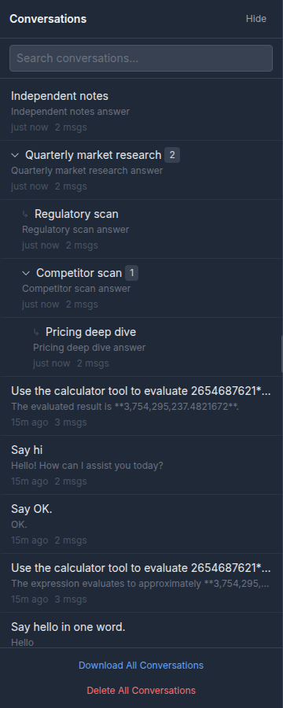
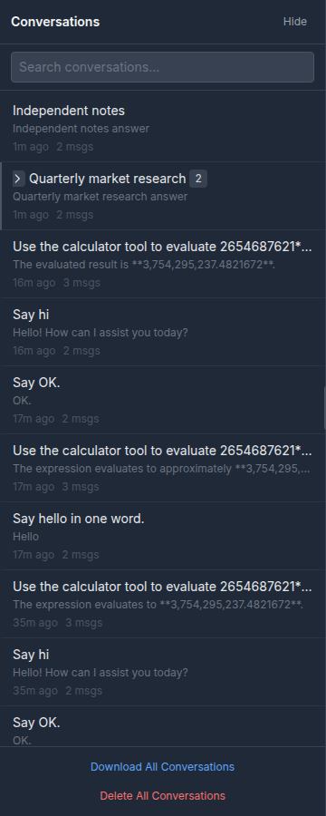

# Parent-child conversations in the sidebar

Date: 2026-10-17

Issue #1081. Builds on the run registry (#884), `atlas_launch` (#925) and
`atlas_follow_up` (#1078).

## Problem

`atlas_launch` starts a daughter conversation, and the run registry already
tracks `parent_run_id`, `parent_conversation_id` and `depth` for it. The
history sidebar ignored all of that: a launched child appeared as an unrelated
conversation, and after the registry reaped the run there was no relationship
left to draw at all. Users could not tell which conversations were launched
together, navigate a parent's fan-out, or see a child's status from the parent.

## Design

### Two sources, one tree

The sidebar needs the hierarchy in two different windows:

1. **While the child is running.** Its conversation is not saved until the
   first turn ends, so there is no conversation record to hold a parent link.
   The live `RunRecord` is the only source. The public run shape now includes
   `parent_conversation_id`, and `run_started` carries it too so a child can be
   nested the moment it is admitted.
2. **After the first save.** The child's durable metadata gains
   `parent_conversation_id`, written from server-side session context by
   `ChatService._save_conversation`. The history listing publishes it. This is
   what keeps the tree after the terminal-run retention window (30 minutes)
   and after a backend restart.

The two sources are merged client-side. A saved link wins over a stale run
record; a run record fills the gap before the save. Nothing persists the run
status itself -- that remains #1080's job -- so after a restart the tree is
complete but live indicators are not.

### The relationship lives on the child

The parent's record is untouched. Putting the link on the child means:

- Re-parenting (out of scope) would be one metadata write, not an edit to the
  parent's child list.
- Deleting a parent cannot corrupt anything; the child simply has a link that
  no longer resolves.
- The relationship query is the ordinary conversation listing, scoped by user
  and by whatever search/tag filter is active. There is no second index and no
  graph database.

`ChatService._hydrate_session_from_store` reads the link back into session
context before a follow-up turn, so the next save does not erase it when the
conversation is rewritten.

### Only a visible parent id is published

`ConversationRepository._visible_parent_ids` checks that each recorded parent
exists and belongs to the same user before any listing, search result, full
record or export exposes the field. A deleted, foreign or filtered-out parent
reads exactly like "no parent", and the frontend renders the child top-level.
The check is in the repository rather than the UI because the UI must not be
the thing that decides whether an id may be disclosed.

No parent fields are copied onto the child, so there is no title, model or
classification leak. Clicking a nested child still uses the normal
`GET /api/conversations/{id}` path, including its ownership and compliance
checks; being a child grants nothing.

A parent on another page still counts for the visibility check: the server
queries the parent by id rather than requiring it to be in the current result
page, so the child's recorded link stays valid. The current sidebar only knows
the rows it fetched, so such a child is still drawn top-level until its parent
appears -- the same as a deleted or search-filtered parent. Search results
deliberately work this way too: a matching child whose parent does not match
the query is shown top-level, because the result set is the user's current
frame of reference.

### Rendering is a flat array in tree order

`arrangeConversations` turns the display rows into a tree and then flattens it
back to an array, attaching `_depth`, `_childCount`, `_hasChildren`,
`_ancestorIds` and `_aggregateRun`. The sidebar keeps rendering one row per
conversation, so search, tags, context menus, active styling and the resizable
panel need no tree-specific branches.

Collapse is a render-time filter on `_ancestorIds`. Rows and their run records
stay in place, so expanding is instant and a collapse can never interact with
an execution. The collapsed set is stored in `localStorage`; when the open
conversation is inside a collapsed group, its ancestors are expanded
automatically.

Cycles and missing parents are resolved to roots before traversal, so malformed
metadata cannot produce infinite recursion or a hidden row.

Status folding uses a fixed priority: `waiting_for_input` > `running` >
`queued` > `failed` > `cancelled` > `completed` (ignored). A collapsed parent
therefore surfaces the child that needs the user instead of a busier sibling.
The marker shows a count when more than one conversation is in the top state.

## Screenshots

Expanded: a parent, its two children, a grandchild and an independent
conversation. The count badge on each parent is its direct child count.

Collapsed: only the parent row remains, with the chevron pointing right. Its
children keep running; expanding restores them unchanged.

## Tests

- `atlas/tests/test_conversation_lineage.py`: metadata helpers, run public
  shape, repository publish/hide rules (deleted, foreign, unknown, pagination),
  export sanitization, save and rehydrate.
- `frontend/src/test/conversation-tree.test.js`: nesting, multiple levels,
  orphans, cycles, live runs, aggregate status, input immutability.
- `frontend/src/test/sidebar-conversation-tree.test.jsx`: rendered nesting,
  child counts, expand/collapse, aggregate marker, navigation, auto-expand and
  orphan rendering.
