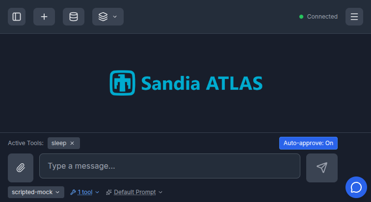
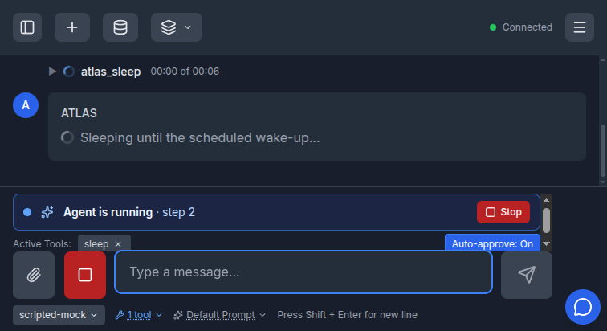
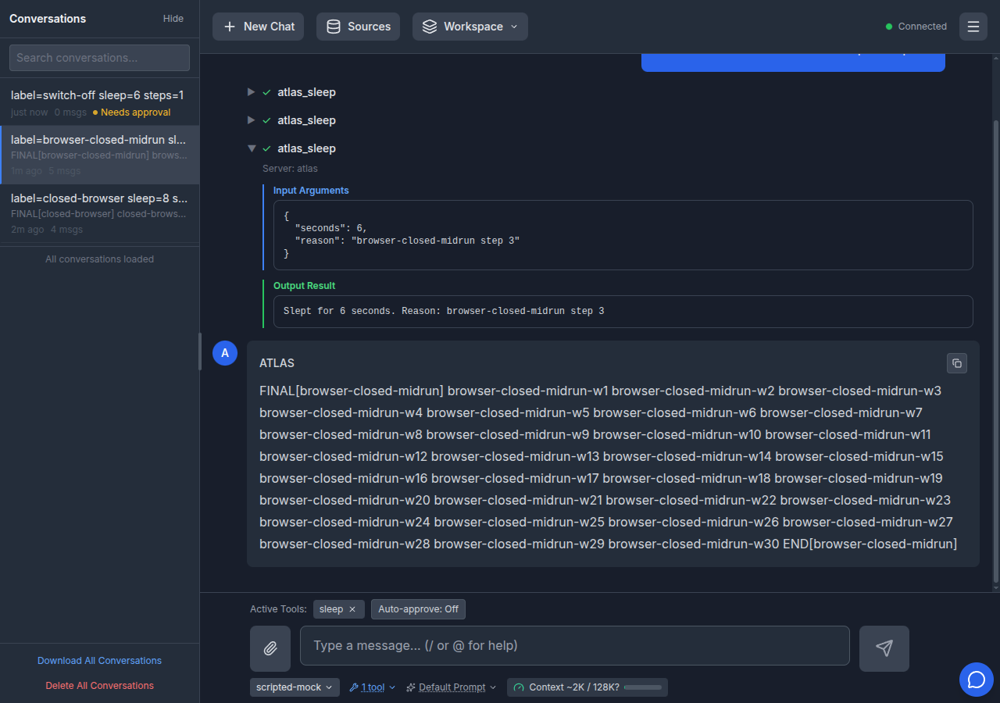
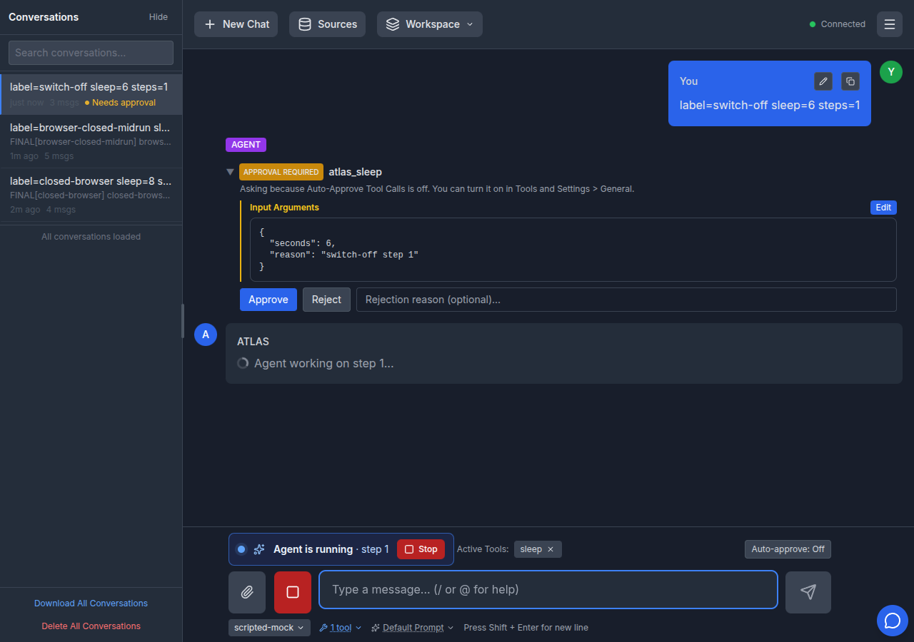

# Server-side auto-approve for background runs

Date: 2026-11-07

PR #1171. Builds on the run registry (#884) and shared run claims (#1128).

## Problem

"Auto-approve tool calls" was answered by the browser page that received the
`tool_approval_request` frame. A tracked run that the user walked away from
(tab closed, laptop lid shut) parked on the approval gate until
`TOOL_APPROVAL_TIMEOUT`, even though the user had opted in to unattended
execution.

## Design

The switch is captured on the `RunRecord` when a run is admitted, and the tool
gate approves user-level tools itself when the record carries it. The browser
is no longer in the loop for those calls. Untracked turns (incognito, local
save, history disabled) store the bit on the connection's session and the gate
reads the live value on each call.

What stays gated regardless of the switch: tools an administrator marked as
requiring approval, calls a `PermissionRequest` or `PreToolUse` hook escalated,
and launched child runs. The server marks those requests `auto_approvable:
false` so the client never answers them on its own either.

The page sends `auto_approve_tools` when the switch changes and once per
connection after the saved settings have loaded, with bounded exponential
backoff while the socket is not yet accepting frames. A chat or steer frame
never changes the switch on a run that is already going.

A chat frame for another conversation now cancels and awaits the untracked
turn still running on that connection before starting the new one. Replacing
the task without cancelling it left a turn that Stop could not reach, and with
the switch on, that orphan kept approving its own tool calls.

## Evidence

Captured against a worktree build of this branch with the scripted mock model
from `test/pr-validation/fixtures/pr1074/` (every `atlas_sleep` call blocks
for the requested seconds, so the approval gate is observable).

The composer switch, on, with the updated help text that names the
closed-browser case:



A three-step run in progress, two seconds after it was sent. The page was then
navigated away, which closed the websocket:



The same conversation reopened after the run finished. Three `atlas_sleep`
calls succeeded and there is no approval row. The server log for this run
shows the third approval five seconds after the disconnect:

```
14:02:02 Tool atlas_sleep auto-approved on the server for user test@test.com (run_id=c595fe55...)
14:02:08 Tool atlas_sleep auto-approved on the server for user test@test.com (run_id=c595fe55...)
14:02:09 Client disconnected; leaving 1 run(s) executing in the background
14:02:14 Tool atlas_sleep auto-approved on the server for user test@test.com (run_id=c595fe55...)
```

(The switch reads Off in this capture because it was turned off for the next
scenario before the finished conversation was reopened.)



With the switch off, the same prompt stops at the gate and asks:



## Known limits

- The switch lives on the replica that owns the run. A live toggle on a
  connection that lands on another replica does not reach that run, which is
  the same limit steering and stop have today. A cross-replica command channel
  is tracked separately.
- The persisted preference is per browser. A second device with an older
  setting announces that value when it connects; a server-side, versioned
  preference would be needed to reconcile devices.
