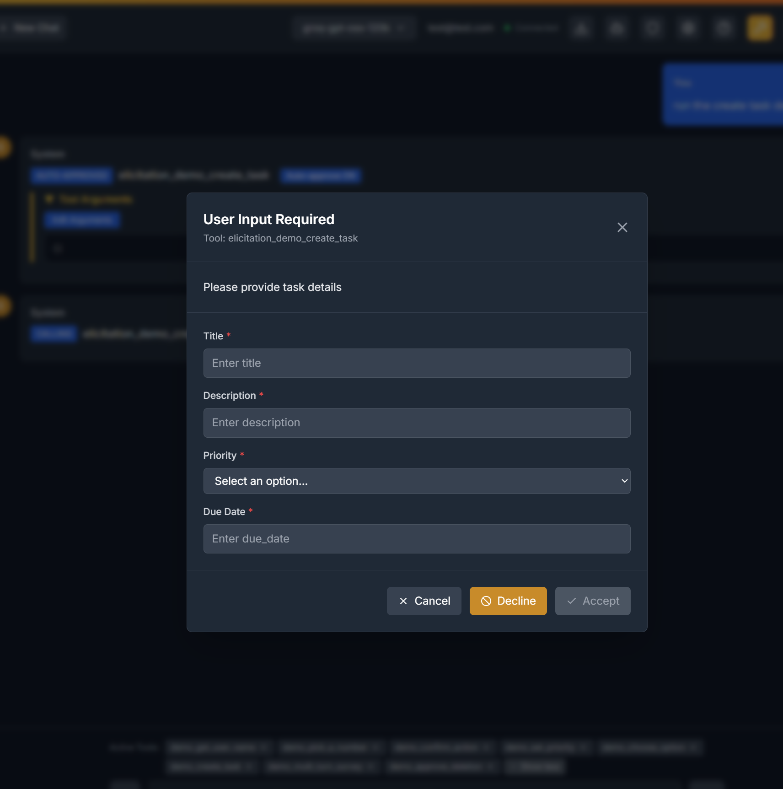
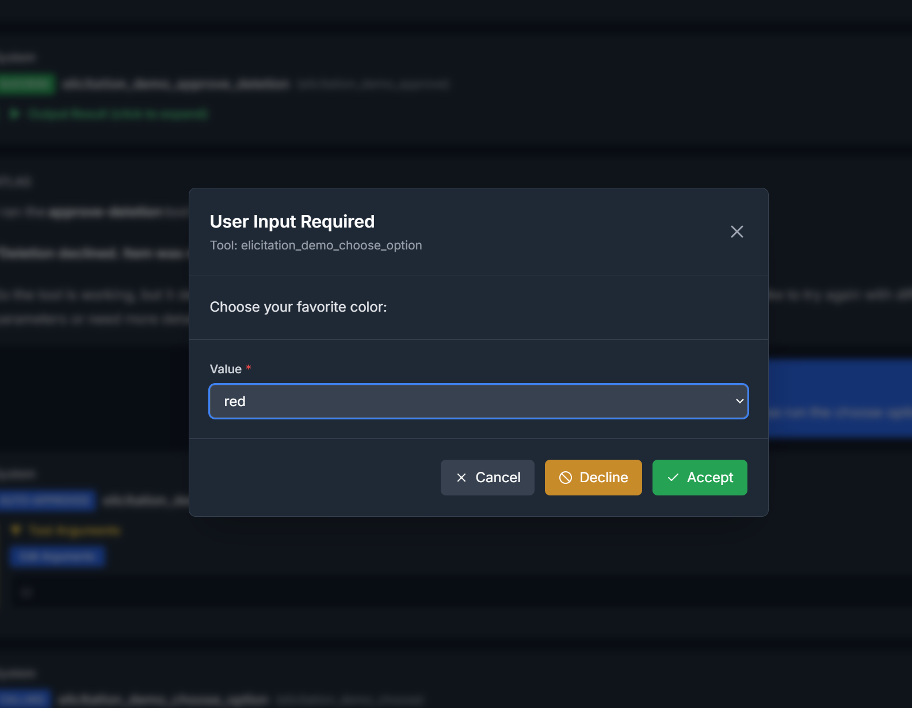

# Interactive Tool Elicitation

Last updated: 2026-11-25

Atlas UI 3 supports **interactive tool elicitation**, an MCP feature that lets a tool ask the user for more information while it runs. Unlike a tool that needs every input up front, an eliciting tool can adapt to what the user tells it.

## What is Elicitation?

Elicitation lets an MCP tool pause and ask the user a question through a dialog. That makes it possible for:

- Tools to gather information progressively
- Users to provide clarification or additional context
- Workflows to adapt based on the answers
- Tools to seek approval before a sensitive operation

## How It Works

When a tool asks for input, Atlas UI 3 shows a modal dialog. The tool continues once you answer.

How the question reaches Atlas depends on the MCP protocol version the server speaks. Atlas negotiates the newest one a server supports and handles both; nothing needs to be configured.

- **MCP 2026-07-28** (FastMCP 4 servers). Server-initiated requests no longer exist. The tool *returns* an `InputRequiredResult` that lists what it needs; Atlas collects the answers and calls the tool again with them. This is "multi round-trip requests" (SEP-2322). One result may carry several questions, and a tool may go through several rounds.
- **MCP 2025-11-25 and older** (FastMCP 3 and earlier). The tool calls `ctx.elicit()`, which sends an `elicitation/create` request to Atlas over the open connection and waits for the reply.

To the user the two look the same.

### Response Types

Tools can request different types of information:

- **Text Input**: Strings, optionally with a format (email, URL, date, date and time) or length limits
- **Number Input**: Numbers or integers, optionally with a minimum and maximum
- **Boolean**: Yes/no questions
- **Single choice**: Pick one from a list; options may have display titles that differ from their values
- **Multiple choice**: Pick any number from a list
- **Structured Forms**: Several fields collected together
- **Multi-turn**: Several dialogs one after another
- **URL**: The tool asks you to open an external page (for example to sign in). Atlas shows the full address and opens it only when you choose **Open link**. Only `http` and `https` addresses are ever shown.

### User Actions

Each elicitation dialog provides these options:

- **Accept**: Submit the provided information and continue tool execution
- **Decline**: Skip providing information (the tool handles this gracefully)
- **Cancel**: Abort the entire operation

If several questions are waiting at once, they are shown one at a time in the order they arrived.

## Dialog Examples

### Task Creation Form

When a tool needs to create a task, it can collect all details at once:



The form requests title, description, priority level, and due date in a single structured dialog.

### Option Selection

For cases where you need to choose from predefined options:



Here the tool presents favorite color choices from which you can select.

## Trying Elicitation

To experience elicitation features:

1. **Access Admin Panel**: Log into Atlas UI 3 and go to the admin panel
2. **Enable Demo Server**: Enable the `elicitation_demo` MCP server
3. **Try These Prompts**:
   - "Create a task by asking me for the details"
   - "Ask me to pick a favorite color"
   - "Get my name and run a survey about my preferences"
   - "Order me a pizza and ask what I want on it"
   - "Test the approval process for a deletion action"

### Available Demo Tools

The elicitation demo MCP server includes these example tools:

- **`get_user_name`**: Basic text input for collecting a name
- **`pick_a_number`**: Integer input
- **`confirm_action`**: Boolean yes/no confirmation
- **`set_priority`**: Enum selection from predefined levels
- **`choose_option`**: String literal selection from color options
- **`choose_toppings`**: A titled single choice and a multi-select, asked in one round trip
- **`create_task`**: Structured form with multiple fields
- **`multi_turn_survey`**: Sequential multi-turn data collection
- **`approve_deletion`**: Yes/no approval before a destructive action

## Writing a Tool That Asks for Input

The bundled servers use `UserInput` from `atlas/mcp_shared/user_input.py`, which works on both protocol versions:

```python
from fastmcp import Context
from mcp_types import InputRequiredResult

from atlas.mcp_shared.user_input import UserInput


@mcp.tool
async def greet(ctx: Context) -> str | InputRequiredResult:
    form = UserInput(ctx)
    name = await form.ask("name", "What's your name?", str)
    if name is None:
        return form.input_required()
    if name.action != "accept":
        return "No name given."
    return f"Hello, {name.data}!"
```

`ask` returns the answer once the user has given it, and `None` while it is still outstanding. Returning `form.input_required()` hands every outstanding question to the client.

Things to know when writing for MCP 2026-07-28:

- **The tool runs again from the top after every answer.** Do not perform a side effect before the last `ask`, or it will happen once per round.
- **Earlier answers are kept for you.** `UserInput` stores them in the result's `request_state`, which FastMCP seals before it leaves the server and checks when it comes back. The server holds nothing between rounds, so this also works on STDIO servers, where session state is blocked.
- **Give each question a stable key.** The key (`"name"` above) is how an answer is matched to its question on the next run.
- **Ask related questions together.** Calling `ask` twice before returning `input_required()` sends both in one round trip.
- **`ctx.elicit()` raises on a 2026-07-28 connection.** `UserInput` only calls it on an older connection.
- **Always ask for a type.** FastMCP 4 rejects `response_type=None`; ask for a `bool` when you only need a yes or no.

Other good practice:

- Prefer one dialog over several when the questions belong together
- Write clear, short prompts
- Handle accept, decline and cancel
- Use the field type that matches the data, so the form can validate it

## Technical Notes

- An unanswered request times out after the configured approval timeout (5 minutes by default). The tool then receives a cancel.
- Tools receive `accept`, `decline` or `cancel`, plus the data on accept.
- The FastMCP client checks an accepted answer against the schema the tool asked for; an answer that does not fit fails the tool call. The dialog enforces required fields, integer values and ranges before it lets you accept. Optional fields left blank are omitted from the answer.
- A request is bound to the user whose tool call raised it. A response from anyone else is rejected (`ElicitationRequest.user_email`).
- On a 2026-07-28 connection a prompt is always delivered to the tool call that asked, because Atlas answers from inside that call. On an older connection the request arrives separately; if more than one call to the same server is in flight and the request does not say which one it belongs to, Atlas cancels it rather than guess.
- An empty schema (confirmation only) is still supported for servers that send one.

## Troubleshooting

**Dialog Not Appearing**: Check that the MCP server is configured and running, and that the tool call has not already timed out.

**"elicitation via server-initiated requests is unavailable on 2026-07-28 connections"**: The server is on FastMCP 4 but its tool still calls `ctx.elicit()`. Change the tool to return an `InputRequiredResult` (see above).

**Tool call fails after Accept with a validation error**: The answer did not match the tool's schema. This usually means the schema uses a shape the dialog does not render as a constrained field.

**Timeout Issues**: Answer before the approval timeout, or the tool receives a cancel.

---

For the demo server's own documentation, see the [Elicitation Demo MCP Server Documentation](../../atlas/mcp/elicitation_demo/README.md). For how the upgrade to FastMCP 4 was done, see the [design note](design-notes/fastmcp-4-mcp-2026-07-28-2026-11-25.md).
