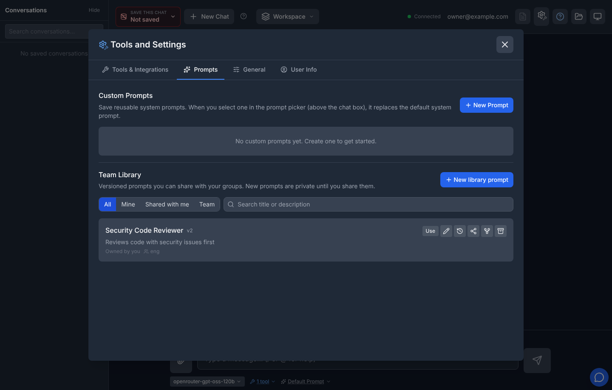
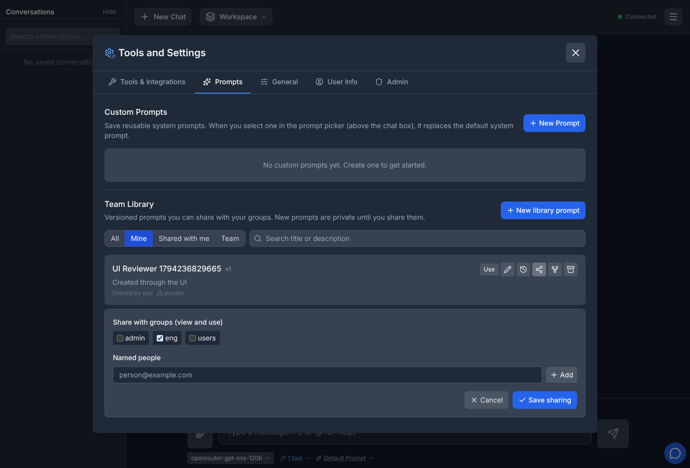
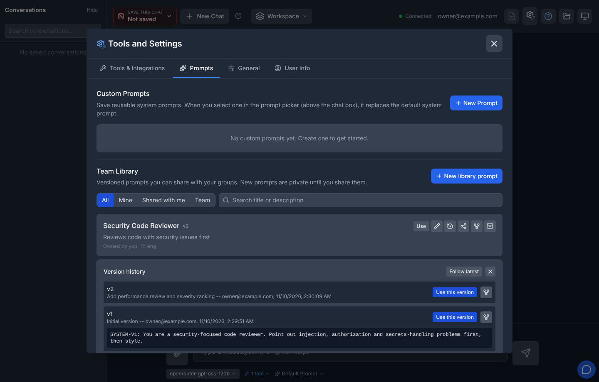

# Team Prompt Library (issue #1169)

Last updated: 2026-11-13

The team prompt library lets you keep versioned system prompts and share them
with the Atlas groups you belong to. It sits next to your private
[custom prompts](../custom-prompts/README.md) in **Tools and Settings ->
Prompts**, and its published entries appear under **Team Library** in the
prompt picker above the chat box.

The library is available whenever custom prompts are (`FEATURE_CUSTOM_PROMPTS_ENABLED`
plus chat history). Private custom prompts keep working exactly as before.

## Browse and search

Filter the list with **All**, **Mine** (entries you own), **Shared with me**
(entries someone shared with you by name) and **Team** (entries shared with a
group you are in), and search by title or description. Each row shows the
owner, how it is shared, the latest published version, and your access level.
You only ever see entries you are allowed to use. On a very large deployment
the list may say that some team prompts could not be checked right now; those
entries are left out rather than guessed.

## Create, edit and publish

**New library prompt** creates a **private** entry: nobody else can see it
until you share it. To bring over an existing private custom prompt, use the
book icon next to it under Custom Prompts (**Save to team library**); it is
copied as a new private entry.

Editing changes the **draft** only. If someone else saved the draft after you
opened it, your save or publish is refused with a message asking you to reload
-- nobody can publish text they did not see. **Publish version** with unsaved
changes saves them first and publishes exactly that save; if someone else
saves in between, the publish is refused. Use **Preview** to read the draft, and
**Test in chat** to try it on your next messages without publishing (the test
selection is not saved and does not affect anyone else). **Publish version**
saves the draft as the next numbered version with an optional change
description. Published versions never change.

## Share

Owners and people with manage permission open the share editor:

- **Groups** let their members view and use published versions. You can only
  share with groups you are a member of, chosen from the groups the share
  editor offers. If Atlas cannot check your membership right now, the change
  is not saved and you are asked to try again shortly. Group membership never allows editing
  or re-sharing. The everyone-group `users` cannot be shared with: the library
  has no organization-wide catalog, and the server refuses such a grant.
- **Named people** can be given **Use**, **Edit & publish**, or **Manage
  sharing**. Only the owner can grant or remove manage permission.

Access is the union of everything that applies to you: leaving one group does
not remove access you still have through another group or a direct grant.
Membership is checked on every request, so changes take effect immediately.

## Versions and chat

Pick an entry in the prompt picker (or **Use** in the library) to follow its
latest version, or open **Version history** to choose a specific version.
The history lists versions newest first, a page at a time (**Load more
versions**); a version's text loads when you open it.

The conversation records the exact version it ran with:

- A conversation keeps that version even after a newer one is published.
  Choose the newer version explicitly to switch.
- Reopening the conversation from the sidebar re-selects that version, even
  when it also restores the conversation's workspace.
- If the entry is unshared, archived, or your access is removed, Atlas refuses
  to run it and asks you to choose another prompt. It never silently switches
  to a different prompt. The conversation's history is kept either way.
- A client that cannot choose a prompt per message (the `atlas-chat` CLI,
  follow-up and API runs, older browser versions) is told how to continue: the
  conversation's owner clears its team prompt with
  `DELETE /api/prompts/pins/{conversation_id}`, and the next run continues
  with the default prompt -- including in a window or session that already has
  the conversation open. Clearing is recorded in the prompt's audit trail.
- If the same conversation is open in two windows and one of them changes or
  clears its team prompt, the other window's next change is refused with "This
  conversation's team prompt was changed in another window or session". That
  window then shows the current selection; check it and send again. Messages
  that keep the current prompt are not affected, and the message only ever
  changes the conversation it is about, even if you have switched to another
  one in the meantime.
- If the conversation (or its stored settings) cannot be loaded -- for example
  a brief database outage -- Atlas refuses the message rather than running it
  with a different prompt; try again once it is back.
- If a conversation's stored prompt settings are damaged, every message is
  refused with a note saying so. Its owner can reset them with
  `DELETE /api/prompts/pins/{conversation_id}`: the damaged team-prompt
  selection is set aside (kept for reference, never guessed) and the
  conversation continues with the default prompt. If nothing in the stored
  settings could be read at all, its data classification is unknown too, so
  the conversation stays closed to chat until an administrator reviews it.
- A message cannot use a team prompt and a custom prompt or persona at the
  same time; such a request is refused with "Choose either a team library
  prompt or a custom prompt, not both."

**Fork** copies a published version into a new private entry you own; changes
to either entry do not affect the other. Owners can **archive** an entry: it
disappears from the library and can no longer be used, while conversations that
used it keep their history. Anyone who still has access can read an archived
entry's published versions and export them; nobody can edit, share or run it.

In the prompt picker, the Team Library section says when it is still loading,
and when the library could not be loaded it says so with a **Retry** button
instead of showing an empty list; your current selection is kept. In the
library panel, a prompt you are editing stays open (marked as not in the
current results) if a search, filter or refresh no longer lists it, so unsaved
changes are not lost.

Saved [workspaces](../workspaces/README.md) can include a library selection.
If you lose access to it, the picker shows **Unavailable team prompt** and the
send is refused until you choose another prompt.

## API

All endpoints take your identity from authentication, never from the request
body. An entry you cannot see answers `404 Prompt not found`, exactly like an id
that does not exist.

| Method | Path | Needs |
|--------|------|-------|
| GET | `/api/prompts?scope=all\|mine\|shared\|team&q=&limit=&offset=` | -- (paged: `{prompts, total, limit, offset}`, plus `incomplete: true` when group checks were cut short; `limit` 1-200, default 50) |
| POST | `/api/prompts` | -- (creates a private entry) |
| GET | `/api/prompts/groups` | -- (`{groups, incomplete}`: groups confirmed as yours, which you may share with) |
| GET | `/api/prompts/{id}` | use (draft only for edit) |
| PUT | `/api/prompts/{id}` | edit (body names `expected_draft_revision`) |
| DELETE | `/api/prompts/{id}` | owner (archives) |
| POST | `/api/prompts/{id}/publish` | edit (body names `expected_draft_revision`) |
| GET | `/api/prompts/{id}/versions?limit=&offset=` | use (paged, newest first: `{versions, total, limit, offset}`; summaries without prompt text) |
| GET | `/api/prompts/{id}/versions/{version_id}` | use (one version, with its content) |
| GET/PUT | `/api/prompts/{id}/sharing` | manage (GET returns `revision`; PUT names `expected_revision`) |
| POST | `/api/prompts/{id}/fork` | use |
| GET | `/api/prompts/{id}/export?offset=` | use (up to 100 versions with content; `versions_total`, `versions_truncated`) |
| GET | `/api/prompts/{id}/audit` | manage |
| GET | `/api/prompts/{id}/resolve?version_id=` | use (read-only advisory check) |
| DELETE | `/api/prompts/pins/{conversation_id}` | conversation owner |

Search (`q`) matches title or description literally; `%` and `_` are not
wildcards. `409` means the draft or sharing changed since you loaded it (reload
and retry); `503` means the library's storage is unavailable.

A chat frame names a library entry with
`"library_prompt": {"prompt_id": "...", "version_id": "..." | null}` (`null` =
latest; `"library_prompt": null` = no library prompt). The server resolves and
authorizes it on every turn; prompt text never comes from the client. A frame
that names an entry and also carries `custom_system_prompt` or `persona_id` is
rejected (`error_type: "validation"`). A frame may also carry
`library_prompt_revision`, the conversation's pin revision the client last
saw (from the conversation, `conversation_saved` frames and conflict errors).
A change to the pin decided on an older revision -- because another window
changed it meanwhile -- is refused with `error_type: "prompt_pin_conflict"`,
and the error carries the current `prompt_library` and
`prompt_library_pin_revision`. See the
[design note](../../developer/design-notes/team-prompt-library-2026-11-09.md)
for the full rules.
